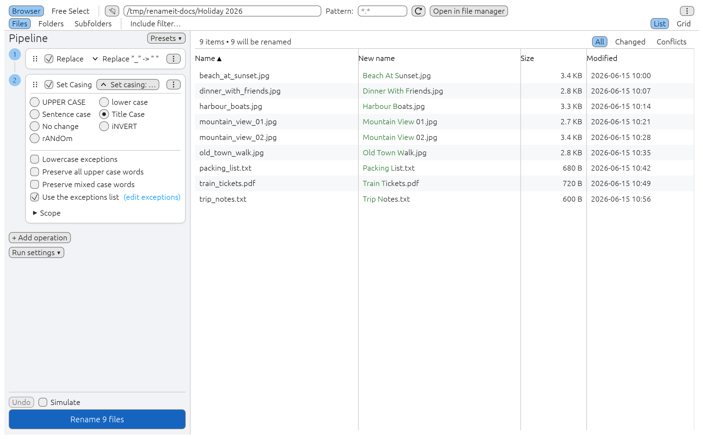
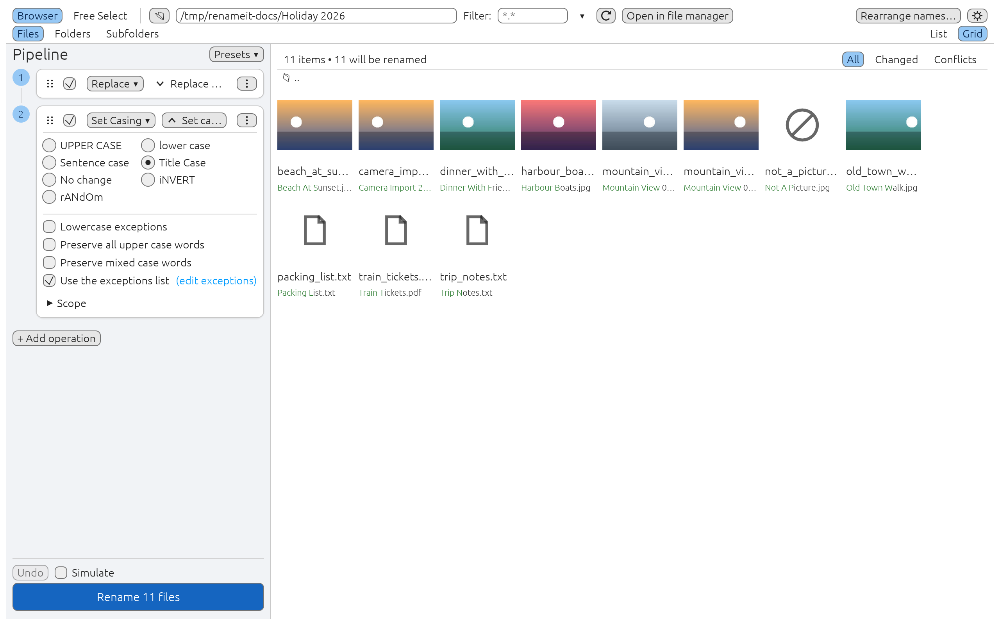
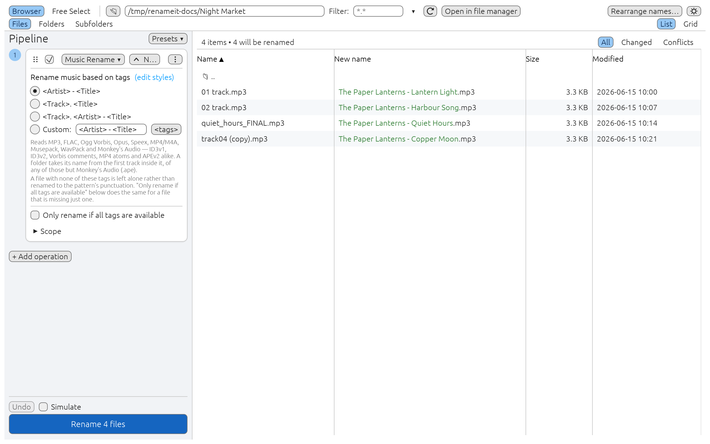
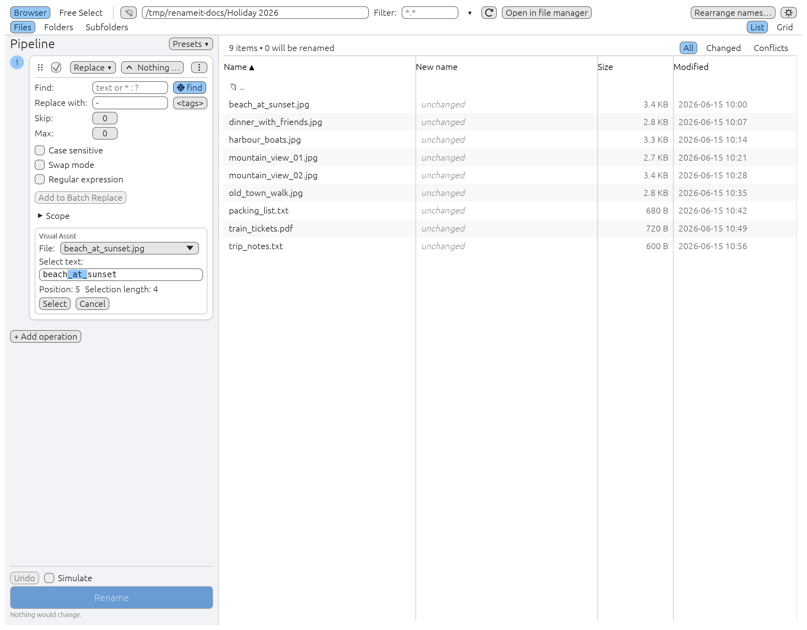
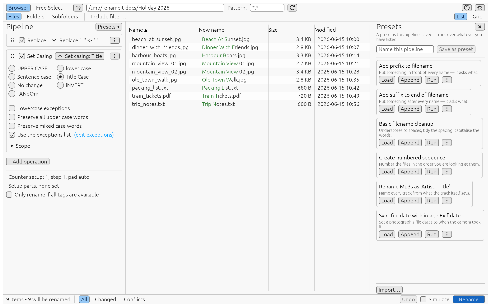
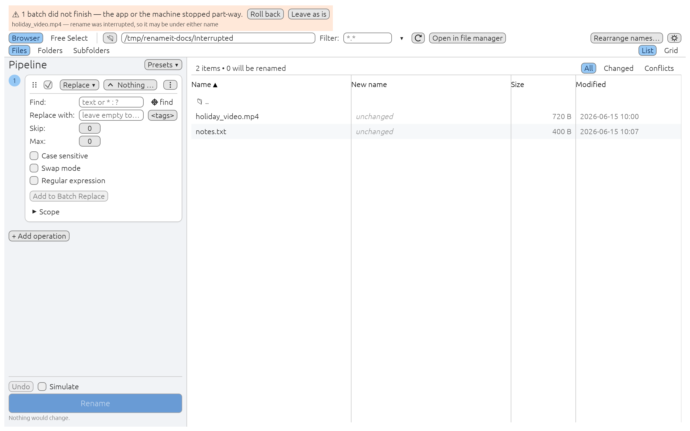

# RenameIt

A batch file renamer written in Rust. Modern UI, cross-platform core, Windows
ships first. MIT licensed.



**Status:** 1.9.0, [released](https://github.com/phoen-ix/renameIt/releases/latest) for Windows and Linux (x64).

Every screen, with a sentence each: [screenshot gallery](docs/screenshots/README.md).

**Contents:** [What it does](#what-it-does) · [Installing](#installing) · [Updates](#updates) · [Building](#building) · [Trying it](#trying-it) · [Music and images](#music-and-images) · [Picking positions by eye](#picking-positions-by-eye) · [Presets](#presets) · [Tags](#tags) · [The app](#the-app) · [Command line](#command-line) · [If a run was interrupted](#if-a-run-was-interrupted) · [Files](#where-renameit-keeps-its-files) · [Portable mode](#portable-mode) · [Workspace](#workspace) · [Quality gate](#the-quality-gate) · [Screenshots](#screenshots) · [E2E](#e2e) · [Documentation](#documentation) · [Releases](#releases) · [Licence](#licence)

## What it does

Browse or drag in files, stack up as many operations as you like, watch the
composed result preview as you type, save the stack as a preset and run it
again later — or from the command line. One rename is one undo, however many
operations produced it.

- **It reads what is *inside* a file:** name a track from its own tags, write
  tags back from the filename, strip tag blocks out, name a photograph from the
  moment it was taken.
- **Scripts:** when none of the seventeen built-in operations fits, the
  eighteenth — a **script** — can do it: sandboxed, with nine worked examples
  shipped.
- **Keyboard:** the full hotkey set, including list navigation.
- **Thumbnails** as both a grid and a column.
- **Visual Assist** on the four pattern fields.
- **Screen-reader support.**
- **Ten Settings pages**, the file-list menu and portable mode.
- **Explorer right-click menu**, offered by the installer: a RenameIt submenu
  on files, folders, drives and folder backgrounds, with one item per preset.
- **The Windows build** carries its own icon and version metadata and links the
  C runtime statically; a tag cuts a release.
- **Installer and updates on Windows:** install for yourself or for everyone,
  and let RenameIt tell you about a new version, or install it when you close
  the window.

## Installing

From the [latest release](https://github.com/phoen-ix/renameIt/releases/latest):

- **Windows installer**, `RenameIt-Setup-<version>.exe`. It installs for you
  alone by default, into `%LOCALAPPDATA%\Programs\RenameIt`, with no
  administrator prompt. *Anyone who uses this computer* installs into
  `Program Files` and asks for an administrator. Uninstalling keeps your
  presets, scripts and undo history unless you say otherwise. Its
  *Right-click menu in Explorer* box (ticked) puts RenameIt on Explorer's
  right-click menu. On a computer several people use, each person gets it at
  their first start and can turn it off for themselves (Settings ▸
  Right-click menu). For scripted installs, `/S` is silent,
  `/CurrentUser` or `/AllUsers` picks the scope and `/NOMENU` leaves the
  menu out: [packaging/README.md](packaging/README.md).
- **Windows zip**, `RenameIt-windows-x64.zip`: a [portable](#portable-mode)
  copy. Unzip it anywhere and run `renameit.exe`.
- **Linux**, `RenameIt-linux-x64.tar.gz`.

`SHA256SUMS.txt` in each release lists the checksum of every file.

## Updates

Settings ▸ Updates, on Windows:

- **Only when I ask**, the default. Nothing goes online until you press
  *Check now*.
- **Once a day — tell me**. The status line says when there is a new
  version.
- **Once a day — install it when I close RenameIt**. Only for a copy installed
  for you alone; one installed for everyone needs an administrator, so it is
  told instead.

*Update to X* downloads the installer, checks it against the release's
`SHA256SUMS.txt`, closes RenameIt, installs it and opens it again. A portable
copy is pointed at the download page.

**Privacy:** a check asks `github.com` which release is the latest. Nothing is
sent but that request, the User-Agent `RenameIt/<version>`, and your IP address,
which any connection carries. An administrator can turn checks off with the
DWORD `HKLM\SOFTWARE\Policies\RenameIt\DisableUpdateCheck` = 1.

## Building

Requires the toolchain pinned in [`rust-toolchain.toml`](rust-toolchain.toml) (rustup installs it
automatically). On Linux the GUI additionally needs:

```sh
sudo apt-get install -y pkg-config libx11-dev libxcursor-dev libxrandr-dev \
  libxi-dev libxkbcommon-dev libxkbcommon-x11-dev libwayland-dev libgl1-mesa-dev
```

```sh
cargo build --workspace
cargo test  --workspace
```

`cargo test` also renders the GUI's snapshot suite, which draws with Mesa's
software Vulkan driver: `sudo apt-get install -y mesa-vulkan-drivers` (see
[Screenshots](#screenshots)).

## Trying it

Try it on a scratch folder, never on the repository — a pipeline renames
whatever folder it is pointed at. From the repository root:

```sh
mkdir -p /tmp/try && touch '/tmp/try/01 - my_first file.txt' /tmp/try/another_file_name.txt
cargo run -p ren-cli -- preview /tmp/try --preset examples/cleanup.toml   # never touches anything
cargo run -p ren-cli -- apply   /tmp/try --preset examples/cleanup.toml
cargo run -p ren-cli -- undo
```

`preview` prints each rename (`01 - my_first file.txt  ->  01. My First File.txt`)
and a count; `apply` does it and names the transaction; `undo` puts it back, from
any folder.

`examples/cleanup.toml` is a **job file** — a TOML listing plus an ordered
pipeline:

- **Used as a preset** (`--preset`), it runs its pipeline over the folder you
  name and says it ignored the file's own `[source]`.
- **Run as a job** (`--job examples/cleanup.toml`), it renames its own
  `dir = "."`, which is read relative to the directory you run the command
  from — the repository, if you run it there.

The schema is the one presets use, so anything you write here loads into the
GUI unchanged:

```toml
[[step]]
op = "replace"
scope = "name"
find = "_"
replace = " "

[[step]]
op = "casing"
mode = "title"
lowercase_exceptions = true
```

The operations, grouped as a card's operation drop-down groups them:

| Group | `op` values |
|---|---|
| General | `replace`, `batch_replace`, `casing`, `add_remove`, `move_section`, `space_trim` |
| Numbers | `add_counter`, `renumber`, `zero_padding` |
| Music | `music_rename`, `music_tagger`, `remove_tags` |
| Advanced | `free_format`, `set_attributes`, `set_date`, `csv_list`, `filename_editor`, `script` |

- **Every step** also takes `scope` (`name` / `extension` / `both`), `enabled`,
  a `[step.filter]` include/exclude filter and a `[step.preproc]` pre-processor.
- **A `[settings]` table** carries the counter, the parts pattern and the tag
  policy, which belong to the run rather than to any one step.
- **Unknown keys are an error**, not a silent default.

Worked examples:

- [`examples/numbered.toml`](examples/numbered.toml): the counter, the `<tag>` engine and `<\>`.
- [`examples/photo-cleanup.toml`](examples/photo-cleanup.toml): a saved preset.
- [`examples/music-rename.toml`](examples/music-rename.toml): names tracks from their tags and files them into
  `<Artist>/<Album>/` subfolders.
- [`examples/camera-import.toml`](examples/camera-import.toml): names photographs from their Exif date and then
  puts that date back on the file.

## Music and images

One set of tag names across every format:

- **Music:** `<Artist>`, `<Title>`, `<Album>`, `<Year>`, `<Genre>`, `<Track>`,
  `<Comment>` and about fifty `<ID3-*>` frame tags. A folder takes its tags
  from the first music file inside it.
  - Read from MP3, FLAC, Ogg Vorbis, Opus, Speex, MP4/M4A, Musepack and WavPack.
- **Exif:** `<Exif-Make>`, `<Exif-Model>` and the rest of the 150 field names
  the Exif standard gives for the primary image, Exif and GPS blocks, plus
  `<ExifDate>` and `<ExifTime>`.
  - A name outside them is an error, not an empty value.
- **Image header:** `<Width>`, `<Height>`, `<Depth>`, `<Depthb>` and
  `<JpgComment>` read the image's own header rather than a camera's Exif block,
  so they answer for a PNG or a BMP where every `<Exif-…>` returns nothing.
  - Read from BMP, GIF, JPEG, PNG, TIFF and TGA.

The same six formats get **thumbnails**, and you choose how:

- **Grid:** `List | Grid` at the end of the source bar switches the whole view
  to tiles.
  - A tile carries the picture, the name on disk and the name the run is about
    to write, so the grid is somewhere you can work rather than only somewhere
    you can look.
- **Thumb column:** in Settings ▸ Columns & rows, it puts a small one beside each row
  instead.
- **Upright:** photographs come back upright whatever your phone wrote in their
  Exif.
- **Cheap:** only what is on screen is ever decoded, so a folder of ten
  thousand costs a screenful of work; and renaming them moves the pictures
  rather than reading them again.





Two operations change what is *inside* a file rather than its name, and neither
can be undone:

- **Music Tagger** writes tags from the filename.
- **Remove Tags** strips ID3v1, ID3v2 and Lyrics3 blocks.

The GUI asks before running one and names the files; the CLI refuses with
exit 2 unless given `--allow-irreversible`. A preset with one such step:

```toml
version = 1

[preset]
name = "Strip ID3v1"

[[step]]
op = "remove_tags"
id3v1 = true
```

```sh
ren-cli apply ~/music --preset strip-v1.toml                        # refused, exit 2
ren-cli apply ~/music --preset strip-v1.toml --allow-irreversible
```

- **Fields you have not ticked are left exactly as they are**, cover art
  included.
  - That sounds obvious and is not: the tag library's save replaces the whole
    tag, so writing only the artist wipes everything else unless the write
    reads first.
- **The file itself is never written:** the change goes into a copy beside it,
  which replaces it only when complete, keeping its modified date. A full disk
  or a pulled USB stick part-way leaves the file as it was.
- **WMA and TTA are not supported** — lofty handles neither. See D55 in
  [`docs/DECISIONS.md`](docs/DECISIONS.md).

## Picking positions by eye

Operations that work by position — Add, Remove, Move Section — and Find &
Replace's *Look For* box each carry a ⌖ button, and **F3** opens the same thing.
It shows the text that operation is handed for one of your files; select part of
it and press **Select** to fill the box.

The text it shows is the operation's own input, which is not always the file
name:

- a card further down the stack sees what the cards above it produced;
- a card set to *Process: Name* sees the stem without its extension.

That is the whole point — a position measured against the wrong string is wrong
by exactly the difference.



## Presets

A preset is this same file with a name and no `[source]` — it runs over whatever
folder you point it at. The app saves them one file per preset in the per-user
data directory; the CLI can list, show, import and export them:

```sh
cargo run -p ren-cli -- presets import examples/photo-cleanup.toml
cargo run -p ren-cli -- presets list
cargo run -p ren-cli -- apply ~/photos --preset "Photo cleanup"
cargo run -p ren-cli -- apply ~/photos --preset "Add prefix to filename" --answer "0=Holiday - "
```

- **`--preset`** takes a path to a `.toml` file, or the **whole** name of a
  preset in the preset folder, ignoring case.
- **The six default presets** — *Add prefix to filename* is one — are written
  the first time the app starts.
  - A machine that has only ever run `ren-cli` has none until you import one;
    `ren-cli presets list` shows what is there.
- **`--job` and `--preset` differ in exactly one way:** a job file brings its
  own source, a preset borrows yours. So `--preset` takes a folder and honours
  `--pattern` / `--folders` / `--subfolders`, and `--job` refuses them.



## Tags

Any field that builds text takes tags — `<Name>`, `<Counter>`, `<Date-yyyy>`,
`<Parent>`, `<%1>`, `<Ask>`, `<Crc32>` and the rest of the list in
[`docs/tags.md`](docs/tags.md). Two things to know:

* **A tag you mistype is an error, not an empty string.** The editor names it
  while you are typing. One silent typo across a thousand files is how a folder
  of music ends up named `.mp3`.
* **`<\>` moves a file into a subfolder** of the folder it is already in,
  creating it if needed — `<Date-yyyy><\><Name>` sorts photos into one folder
  per year.
  * Undo puts the files back and removes the folders it created, but never one
    you have since put something else into.
  * A produced name can go down; it can never go up or out.

## The app

```sh
cargo run -p ren-gui                                   # the app
xvfb-run -a cargo run -p ren-gui                       # on a headless box
```

The window:

- **Source bar** on top, with ⚙ Settings at its right. *Open in Explorer*
  opens the folder you are browsing.
- **Pipeline** on the left: the operations as numbered steps, and at its foot
  Undo, Simulate and **Rename N files**. A card that uses the counter, the
  filename parts or file tags shows those shared settings inside it. The
  button says how many files it will touch, and when it cannot run it says
  why underneath — a conflict blocks the whole run rather than skipping a
  file.
- **File table** (virtualized): the counts and the All / Changed / Conflicts
  filter above it, then old and new names with the changed part highlighted.

### Launching it

```text
renameit [PATH]... [--start-in] [--preset FILE] [--copy-names]
```

| Argument | Does |
|---|---|
| `PATH`… | Files or folders to open. One folder browses there; anything else is Free Select, the same reading a drag gets. |
| `--start-in` | Browse the folder the first path is in (a folder browses itself). |
| `--preset FILE` | Load a saved pipeline before the preview. A **path**, never a name: two presets may share one. The preview is shown; nothing is renamed. |
| `--copy-names` | Put the names of the given files on the clipboard, one per line, sorted, and exit without a window. |
| `--from-shell` | Written by the Explorer menu; nobody needs to type it. |

The parser never fails: anything it does not understand is read as a path, and
the status line says so. A release build has no console, so `renameit --help`
prints to nowhere on Windows — this table and `ren-cli --help` are the
documented places.

### Keyboard

| Key | Does |
|---|---|
| **F2** | Rename the row under the keyboard in place. The stem is selected; **Enter** renames and moves to the next row, **Escape** cancels. Honours Simulate. Refused while a run is going or the list is updating; a rename that fails says so in the status line. |
| **F3** | Visual Assist: open, cycle through the card's ⌖ targets, close. |
| **F4** or **Ctrl+Z** | Undo the last batch. |
| **F5** | Rename (run the plan). |
| **F6** | Put the keyboard in the address box (Browser mode). |
| **F8** | Settings. |
| **F9** | Forget everything read from inside the files, then list the folder again — the same as the ⟳ button. |
| **F12** | Pick a folder (Browser mode). |
| **Ctrl+K** | Add a card of the default operation (Settings ▸ Default operation). |
| **↑ ↓ Home End** | Move through the list. **Shift** extends the selection; **Ctrl** moves the keyboard and leaves the selection alone. |
| **Ctrl+A** | Select every row on screen. |
| **Enter** / **Backspace** | Into the folder under the keyboard / up to the parent (Browser mode; Enter needs the Folders chip). Double-clicking `..` above the list goes up too. |
| **Delete** | Free Select only: take the selected rows out of the list. The files are untouched; nothing in the app deletes from disk. |
| **Ctrl +** / **Ctrl −** / **Ctrl 0** | Interface size (also in Settings ▸ Appearance). |
| **Enter** in the `<Ask>` prompt | Answer and rename. |

Three rules decide when a key acts:

- **Exact modifiers:** Ctrl+Shift+Z is not undo, and Alt+F4 is not F4.
- **Not while you type:** in a text box the keys are the box's own — except F3,
  and except the F-keys in a number box (Ctrl+Z there undoes the digit).
- **Not behind a dialog:** with Settings, About, the `<Ask>`
  prompt or a confirmation open, no shortcut acts.

F1 is not bound. Closing the window while a run, an undo or a rollback is going
waits for it to finish; Cancel stops a run sooner, between two files.

## Command line

`ren-cli` previews, applies, undoes and recovers runs and manages the preset
folder; an old slash-switch command line (`/p /l /r …`) still works. Commands,
flags, exit codes and the legacy switches: [docs/cli.md](docs/cli.md), or
`ren-cli --help`.

## If a run was interrupted

Every rename is written to a journal before it happens, so a crash, a power cut
or a killed process leaves a record of exactly what was under way.

* **In the app**, a banner appears at the next start: *N batches did not
  finish*. It names each file that was mid-change.
  * **Roll back** puts back what those batches did; **Leave as is** hides the
    banner and keeps the journals.
  * A journal another RenameIt window is still writing is named as running and
    is never offered for rollback.

  

* **From the command line**, `ren-cli recover` lists the same, and
  `ren-cli recover --rollback` reverts them. An `apply` that exits 3 is the cue.
* **Cancel** during a run is not an interruption: it stops between two files,
  the run is recorded as finished, and Undo takes back exactly what happened.
* **What rollback and undo cannot restore:** a tag write or tag removal.
  * Those go through a copy that is swapped in whole, so a file is either as it
    was or fully changed — never half-written — but the old tags are gone.
* **A file changed since** (someone renamed or edited it, so it no longer
  matches the journal) is **skipped** and listed, never forced. A date is
  compared with two seconds' tolerance, because FAT stores times to two seconds.

## Where RenameIt keeps its files

The undo journal, presets, scripts and settings live in a per-user folder (on
Windows under `%APPDATA%\RenameIt`), or in `RenameIt-data` beside a portable
copy. Settings ▸ Where files are kept shows which this copy uses; `ren-cli` uses the
same folders, so `ren-cli undo` can undo a batch the app ran. The table for
each OS: [docs/cli.md](docs/cli.md#where-renameit-keeps-its-files).

## Portable mode

A copy that keeps everything beside itself. Put a file called
`renameit-portable.txt` next to the executable and presets, scripts, the undo
journal and the window layout all move into `RenameIt-data/` in that folder —
so copying the folder to a stick takes them with it. The release zip ships the
marker already; delete it to get the ordinary per-user behaviour. The installer
leaves it out.

Two conditions, both required: the marker has to be there, and its folder has to
be **writable**. A copy in `Program Files` or on a read-only share declines the
portable path rather than taking it and failing on every write. Settings ▸
Where files are kept says which mode you are in and where the files actually are.

## Workspace

| Crate | Role |
|---|---|
| `crates/ren-core` | The engine: operations, pipeline, planner, conflict detection, transactional executor, journal-backed undo, metadata readers, scripting. No GUI dependencies and no OS behaviour; its only platform-conditional code is std's lossless path encoding in the journal (D240). |
| `crates/ren-platform` | `trait Platform` — renames, DOS attributes, file times, naming rules, the system-folder guard, shell integration. Everything OS-specific lives here (D3). |
| `crates/ren-cli` | Headless runner. The automation story and the test harness; ships in every release. |
| `crates/ren-gui` | The desktop app (egui/eframe). |

`docs/DESIGN.md` Part 4 has a module map of each crate and the app's worker
threads.

## The quality gate

Everything in it must be green before a session ends: fmt, clippy (Linux and
the Windows target), the tests in UTC and in `TZ=Asia/Kolkata`, `cargo deny`,
the no-`wgpu` check and the performance budgets. The commands and what their
output means: [`CLAUDE.md`](CLAUDE.md#the-quality-gate).

## Screenshots

Every image in [`docs/screenshots/`](docs/screenshots/README.md) — the gallery
there walks through each screen — is a test as well as a picture.
`crates/ren-gui/tests/snapshots.rs` drives the real window to each screen,
renders it at 2× on Mesa's lavapipe, and fails when the result no longer matches
the committed image (Linux only, D248). After a change that moves pixels:

```sh
sudo apt-get install -y mesa-vulkan-drivers                  # once: the software renderer
UPDATE_SNAPSHOTS=1 cargo test -p ren-gui --test snapshots    # rewrite the images that changed
scripts/docs-screenshots.sh [outdir]                         # or render all of them, then oxipng
```

Look at every changed PNG before committing it. The manual **Docs screenshots**
workflow on GitHub renders the same set and returns it as an artifact.

## E2E

`scripts/e2e.sh` runs the end-to-end suites. These drive the GUI through its
accessibility tree (`crates/ren-gui/tests/gui.rs` and `e2e.rs`) and run
`ren-cli` as a process (`crates/ren-cli/tests/`). There is no stack to start
and no port to free. [`docs/COVERAGE.md`](docs/COVERAGE.md) maps every GUI
feature and every CLI flag to its test. CI runs the suite as its `e2e` job.

## Documentation

- [`CLAUDE.md`](CLAUDE.md) — how to work in this repo
- [`docs/DECISIONS.md`](docs/DECISIONS.md) — **the authority** on every policy and technology call
- [`docs/DESIGN.md`](docs/DESIGN.md) — architecture: engine model, GUI/UX screens, quality strategy, and Part 4, the app as built
- [`docs/cli.md`](docs/cli.md) — `ren-cli`, its exit codes and legacy switches, and where the files live
- [`docs/tags.md`](docs/tags.md) — the `<tag>` reference
- [`docs/MIGRATION-legacy-scripts.md`](docs/MIGRATION-legacy-scripts.md) — porting a legacy `.frs` script to Koto
- [`docs/spikes/`](docs/spikes/) — written verdicts on the risky assumptions
- [`docs/manual-checks.md`](docs/manual-checks.md) — the few things CI cannot prove, and how to check them
- [`docs/COVERAGE.md`](docs/COVERAGE.md) — every GUI feature and CLI flag mapped to its e2e test
- [`docs/screenshots/README.md`](docs/screenshots/README.md) — every screen, one picture each

## Releases

- **Push `main` first and let CI go green**, then tag:
  `git tag -a v1.9.0 -m "1.9.0" && git push origin v1.9.0`.
- **The tag runs** [`.github/workflows/release.yml`](.github/workflows/release.yml), which builds, packages
  `RenameIt-Setup-<version>.exe`, `RenameIt-windows-x64.zip` **and**
  `RenameIt-linux-x64.tar.gz`, writes `SHA256SUMS.txt` over all three, and drafts a
  GitHub release whose notes are the newest section of [`CHANGELOG.md`](CHANGELOG.md).
  The tag must be `v` plus the workspace version, because the updater builds the
  installer's name from it.
- **Draft, not published:** the tag is the act of building, and deciding it is
  fit to hand out is a separate one. **Publishing is what offers the version
  to every installed copy** that checks for updates (D250).
- **Each archive is built from an explicit list** rather than by sweeping a
  directory. It carries the licence notices of everything the programs link
  (`THIRD-PARTY-LICENSES.html`, generated by [`cargo-about`](about.toml)), the font
  notices, and the two docs the app points at.
- **The order matters** because the release **does not re-run the tests** — it
  checks that CI already passed on the exact commit the tag points at, and
  refuses otherwise.
  - A tag does not trigger CI, so tagging before CI finishes is a refusal
    rather than a wait: sleeping on a paid runner would cost the minutes that
    check exists to save.

The application icon is ours, drawn by [`assets/icon.py`](assets/icon.py) and committed with its
generator so that stays checkable. It needs Pillow:

```sh
python3 assets/icon.py    # rewrites crates/ren-gui/assets/renameit.ico, renameit-256.png and renameit-64.rgba
```

## Licence

MIT — see [`LICENSE`](LICENSE). Bundled fonts are OFL-1.1, and egui's own under
their licences; see [`THIRD-PARTY-FONTS.md`](THIRD-PARTY-FONTS.md). A release
archive lists every linked crate's licence in `THIRD-PARTY-LICENSES.html`.
