# RenameIt user guide

How to rename files with the RenameIt app, task by task, and every Settings page.

Audience: anyone renaming files with the RenameIt app (the command line is in [cli.md](cli.md)).

Overview and installation: [README](../README.md). Every screen with a sentence each: [screenshot gallery](screenshots/README.md). The `<tag>` reference: [tags.md](tags.md). Command line and file locations: [cli.md](cli.md).

**Contents:** [The window](#the-window) · [Opening files](#opening-files) · [Building a pipeline](#building-a-pipeline) · [Reading the preview](#reading-the-preview) · [Renaming, Simulate and Undo](#renaming-simulate-and-undo) · [The file list](#the-file-list) · [Picking positions by eye](#picking-positions-by-eye) · [Rearrange](#rearrange) · [Music and images](#music-and-images) · [Tags and Ask](#tags-and-ask) · [Presets](#presets) · [If a run was interrupted](#if-a-run-was-interrupted) · [Settings](#settings) · [Keyboard](#keyboard) · [Installing, portable mode and files](#installing-portable-mode-and-files)

## The window

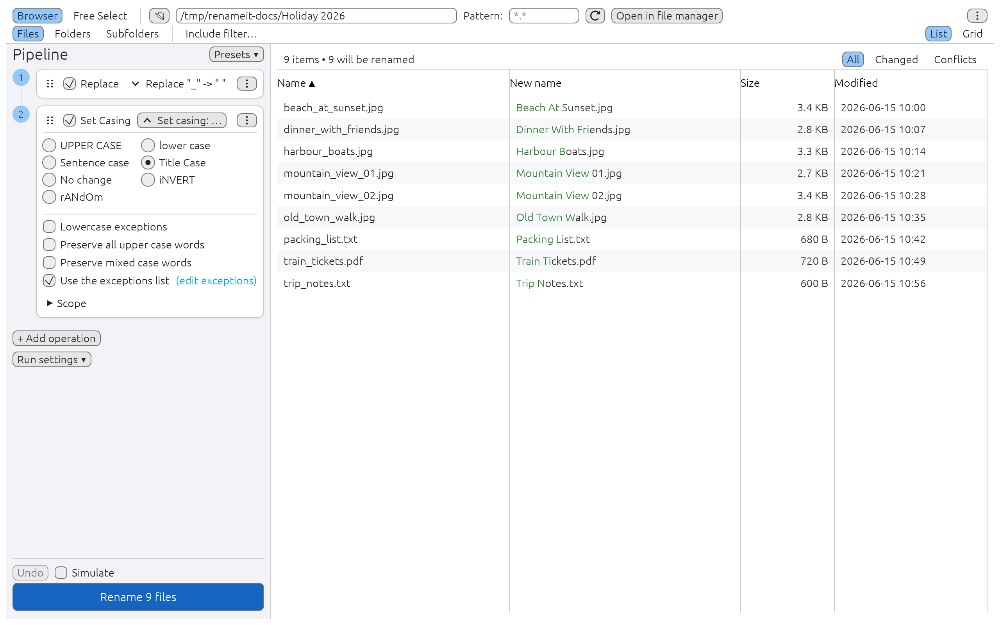

- **Source bar** across the top:
  - First row: **Browser** | **Free Select**, then (in Browser) 📂, the address box, **Filter:** with its ▾, ⟳ and **Open in Explorer** (**Open in file manager** outside Windows). **Rearrange names…** and ⚙ (Settings) sit at the right.
  - Second row: the **Files**, **Folders** and **Subfolders** chips, and **List** | **Grid** at the right.
- **Pipeline** on the left: **Presets ▾**, the operation cards as numbered steps, **+ Add operation**, and at the foot **Undo**, **Simulate**, **Log** (once there is a log) and the big **Rename** button. When Rename cannot run, the reason is printed under it.
- **File list** on the right (it draws only the rows on screen, so a folder of ten thousand stays quick): a summary line (*9 items • 9 will be renamed*), the **All** / **Changed** / **Conflicts** filter, then the old and new names with the changed part highlighted.

The same window in the dark theme (Settings → [Appearance](#appearance)):

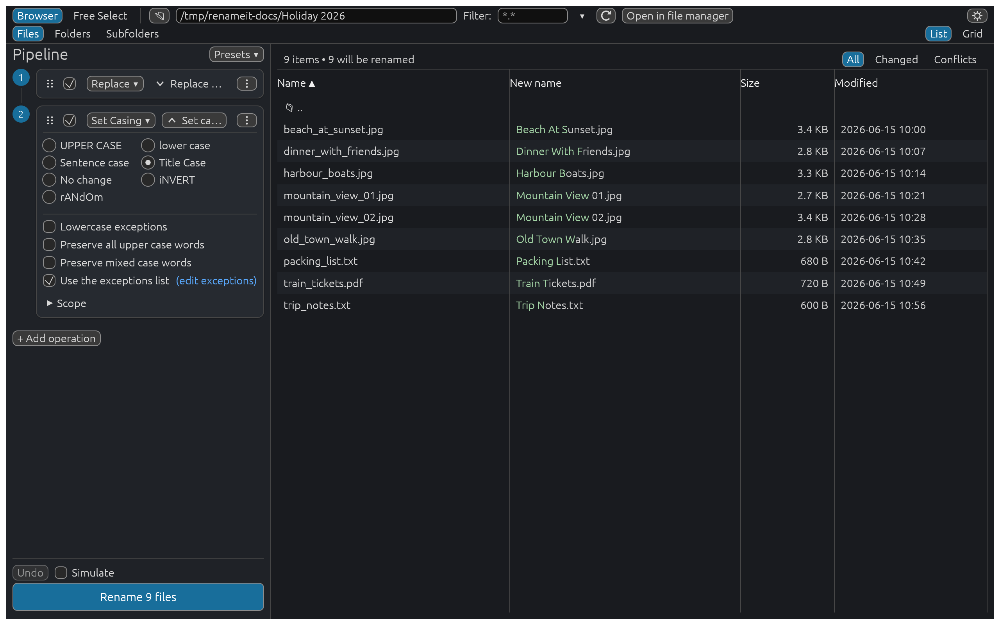

A folder with nothing in it says **Nothing here** and how to fill the list. With no cards in the pipeline, Rename says *The pipeline is empty — add an operation.*

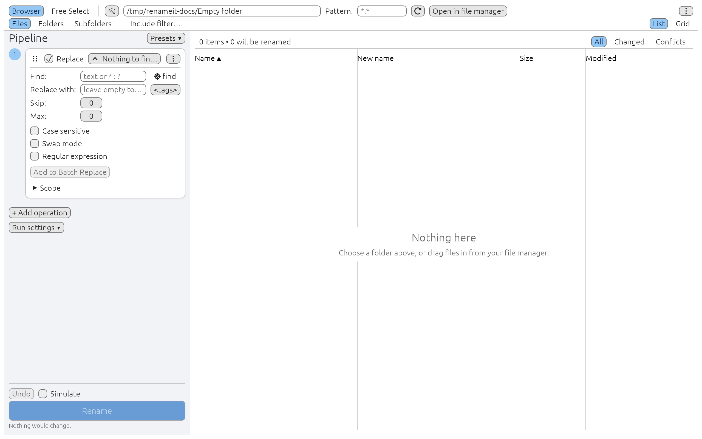

## Opening files

The **Browser** lists one folder:

1. Click **Browser**.
2. Press 📂 (or **F12**) and pick a folder, or type a path in the address box (**F6** puts the keyboard there) and press **Enter**.
3. Choose what is listed with the chips: **Files** (on by default), **Folders**, **Subfolders**.
4. To narrow the list, type a mask in **Filter:**, such as `*.jpg`. Plain text matches anywhere in the name; `*` is any run of characters, `?` exactly one. The ▾ beside it holds **Exclude:**, **Wildcards** / **Regular expression**, **Test the whole path** and **Match case**; it is lit while any of them is set.

⟳ (**F9**) lists the folder again and forgets everything read from inside the files, such as tags. A row that could not be read is counted beside the path: *⚠ N item(s) could not be read*.

**Free Select** holds files picked from anywhere, so one run can mix folders:

- Drag files from your file manager onto the window. Dropping one folder while in Browser browses into it; anything else switches to Free Select.
- Or click **Free Select** → **Add files…**. **Clear** empties the list; the bar counts *N file(s) from M folder(s)*.
- In Browser, right-click rows → **Add to Free Select** moves them there.
- **Delete** (or the row menu's **Remove from Free Select**) takes the selected rows out of the list. The files are untouched; nothing in the app deletes from disk.

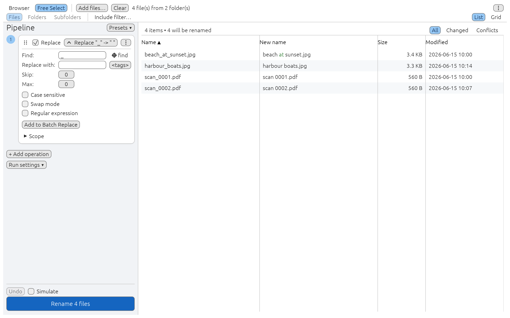

Names in any writing system work: the bundled fonts cover Japanese, Chinese, Korean, Thai, Devanagari, Arabic, Hebrew, Greek and Cyrillic, plus monochrome emoji. Right-to-left names keep their letters joined; their word order is a known gap.

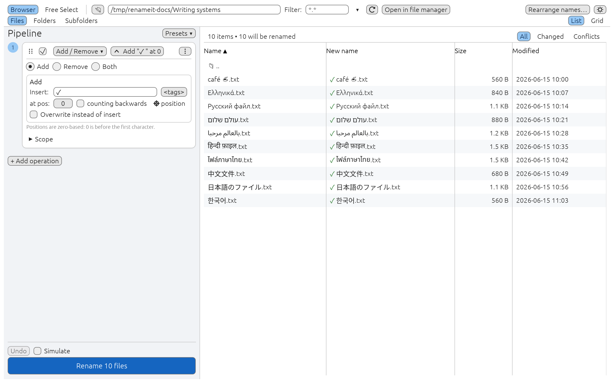

## Building a pipeline

A pipeline is a stack of operation cards. Each card works on what the cards above it produced, and the preview shows the result of the whole stack as you type.

1. Press **+ Add operation** (**Ctrl+K**). The new card is the default operation, **Replace** out of the box (Settings → [Default operation](#default-operation)).
2. Open the card's drop-down (the operation's name with ▾) and pick the operation. It lists all eighteen in four groups: **General**, **Numbers**, **Music**, **Advanced**.
3. Fill in the card. A field that builds text has a **`<tags>`** button beside it ([Tags and Ask](#tags-and-ask)).
4. Click a card's summary to open or close it; one card is open at a time.

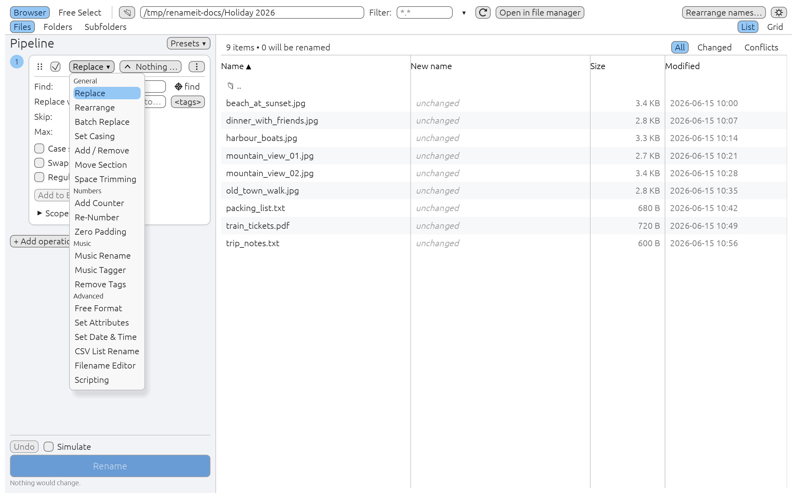

On each card:

- **Drag the grip** (⠿) to reorder, or use the ⋮ menu: **Move up**, **Move down**, **Duplicate**, **Delete**.
- **The checkbox** includes the card in the run. Untick it to see the result without it; the summary is struck through.
- **Scope** (collapsed at the foot of the card): **Apply to** **Name**, **Extension** or **Both** (the extension is everything after the last period), **Use a filter for this operation only**, and a pre-processor that hands the card only one section of the name. An operation that changes the file rather than its name (Set Attributes, Set Date & Time, Music Tagger, Remove Tags) offers only the filter.
- **A card that cannot run** says why in red, even while closed.
- **Shared settings:** a card that uses the counter, the filename parts (`<%1>` … `<%9>`) or file tags shows the **Counter**, **Filename parts** or **Only rename if all tags are available** section inside it, marked *shared by every card*. They belong to the run, not to the card.

## Reading the preview

Each row shows the name on disk and the name the run will write, with the changed part in green. A row the run leaves alone says *unchanged*; a row outside the selection shows —.

The summary line above the list counts items, renames, modifications, conflicts, errors, files left alone and the selection. **Changed** and **Conflicts** filter the list to those rows.

A **conflict** (⛔) is a new name that would collide: two files want the same name, the name already exists, the machine cannot make the change, or a file is in the way. An **error** (✖) is a row that could not be previewed. Hover the badge for the reason and what to do.

A conflict blocks the whole run rather than skipping a file: **Rename** is greyed out and the reason is printed under it.

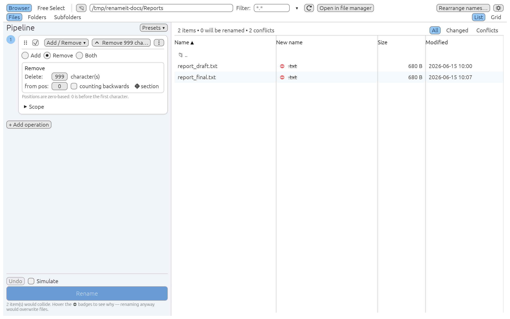

## Renaming, Simulate and Undo

1. Check the preview.
2. Press **Rename N files** (**F5**). The label says what will happen: **Rename N files** (or *items* when folders are included), **Run on N files** when only file contents or attributes change, **Simulate N files** with Simulate ticked.
3. A run that writes tags, removes tags or lets a script write a file asks first ([Music and images](#music-and-images)); a pipeline with `<Ask>` asks for the text ([Tags and Ask](#tags-and-ask)). An ordinary rename does not ask.
4. While it runs, the footer shows *Renaming X of Y…* and **Cancel**, which stops before the next file. What was renamed stays renamed, and Undo takes it back.

Afterwards the list shows the new names, the status line says what happened, and **Log** toggles the list of changes underneath.

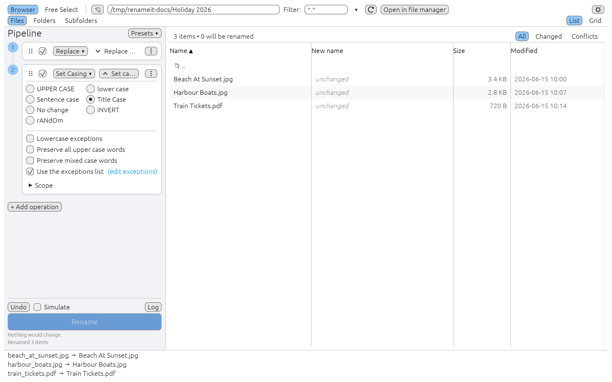

**Undo** (**F4** or **Ctrl+Z**) takes back the last batch of this session, however many operations produced it; press again for the one before. *Nothing to undo yet* when there is none. A tag write or tag removal cannot be undone.

**Simulate** runs the whole plan without touching the disk:

1. Tick **Simulate** and press **Simulate N files**.
2. The **Simulation result** window lists every change, old against new. Filter with **All**, **Renamed**, **Other changes** and **Failed**, search with **Search:**, and tick **Full paths** to see folders.
3. **Copy list** copies the rows shown as tab-separated text. **Rename now** runs it for real; Simulate stays ticked for next time. **Close** leaves everything as it was.

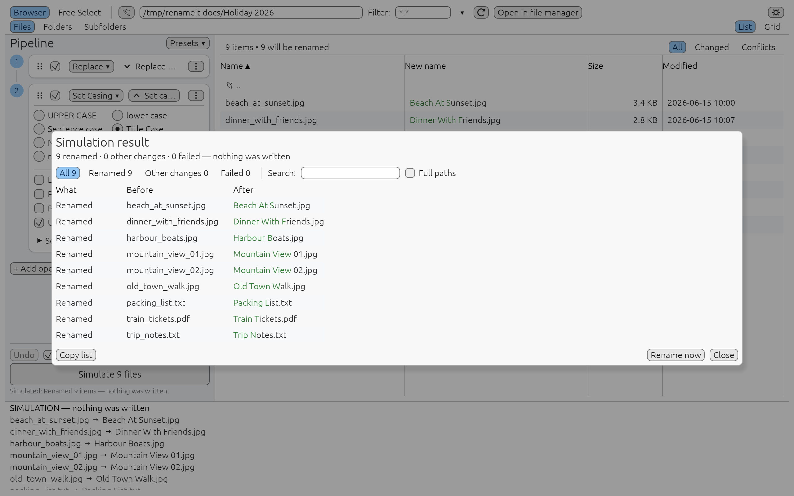

## The file list

**Selecting rows scopes the run:** with rows selected, only those are renamed; with none, every row is. Click selects, **Ctrl**-click adds, **Shift**-click extends, **Ctrl+A** selects every row on screen. A row hidden by the filter is never selected.

**Right-click a row** to make it the selection and open the row menu:

- **Rename…** edits the name in place.
- **Show in file manager** shows it in your file manager.
- **Rearrange like this…** opens [Rearrange](#rearrange) with this name as the sample.
- **Copy to clipboard** → **Names**, **New names**, **Full paths** or **Name and new name**, for the selection (or all rows).
- **Add to Free Select** (Browser) or **Remove from Free Select** (Free Select).

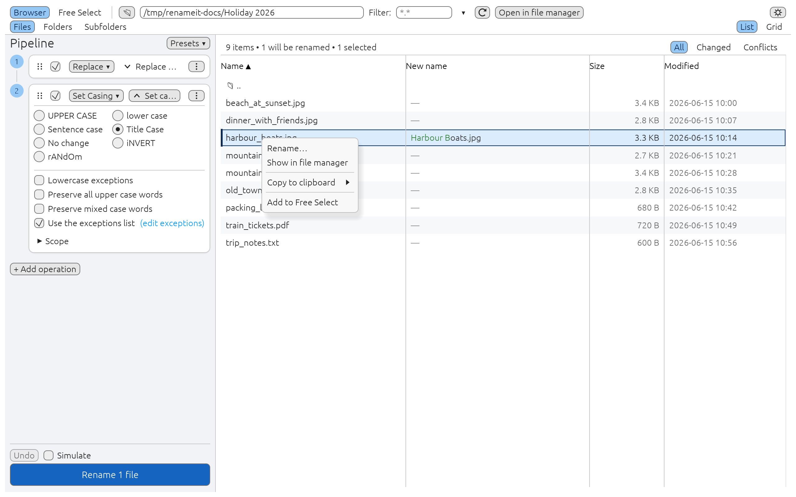

**Renaming one file by hand:** press **F2**, right-click → **Rename…**, double-click a file, or click a selected name again, slowly. The stem is selected; **Enter** renames and moves to the next row, **Escape** cancels. It honours Simulate.

**Folders:** a double-click on a folder (or **Enter**) opens it; **Backspace**, or a double-click on `..` above the list, goes up. What a double-click on a file does is set in Settings → [Columns & rows](#columns--rows).

**Sorting:** click a column header to sort by it; click again to reverse. Clicking **New name** reorders the list once by the names it is about to write. The list order is the run order, so a counter added afterwards numbers the files that way.

**Grid:** **List** | **Grid** at the end of the source bar switches to tiles. A tile carries the picture, the name on disk and the name the run is about to write, so you can work in the grid as in the list. A long name is clipped, and a file that is not a picture shows ⊘ or a page icon.

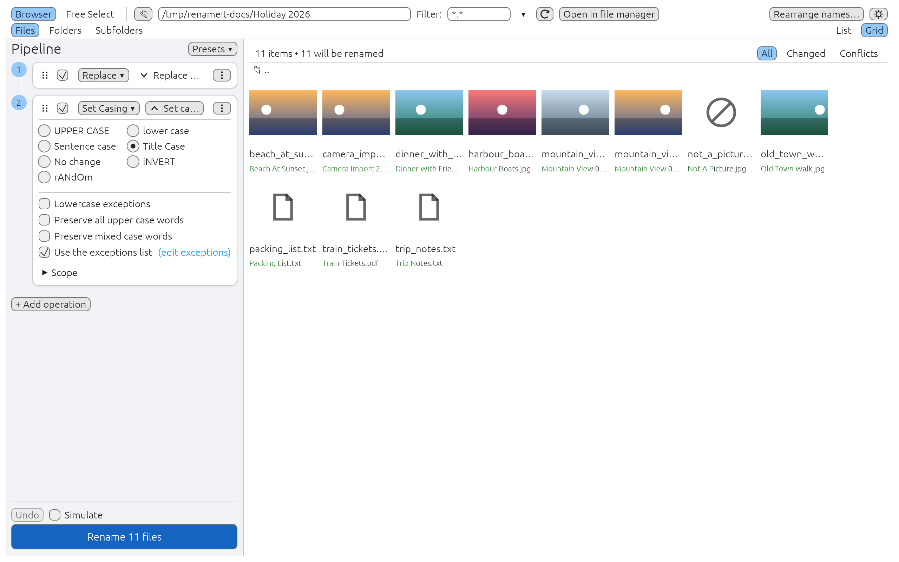

Thumbnails cover BMP, GIF, JPEG, PNG, TIFF and TGA:

- **Thumb column:** tick **Thumb** in Settings → [Columns & rows](#columns--rows) for a small picture beside each row instead.
- **Upright:** photographs come back upright whatever your phone wrote in their Exif.
- **Cheap:** only what is on screen is decoded, so a folder of ten thousand costs a screenful of work, and renaming moves the pictures rather than reading them again.

Size and border: Settings → [Thumbnails](#thumbnails).

## Picking positions by eye

Operations that work by position (Add / Remove, Move Section) and Replace's **Find:** box carry a ⌖ button: **⌖ find**, **⌖ position**, **⌖ section** or **⌖ cut**.

1. Open the card and press its ⌖ button (or **F3**).
2. Pick a file under **File:**. The box shows the text this operation is handed for that file.
3. Select part of it (or place the cursor, for a position). **Position:** and **Selection length:** follow.
4. Press **Select** to fill the field, or **Cancel**.

**F3** cycles through the open card's ⌖ targets and then closes the strip.

The text shown is the operation's own input, which is not always the file name:

- a card further down the stack sees what the cards above it produced;
- a card whose Scope is **Apply to: Name** sees the stem without its extension.

That is the point: a position measured against the wrong string is wrong by exactly the difference. A Scripting card above this one is not reflected.

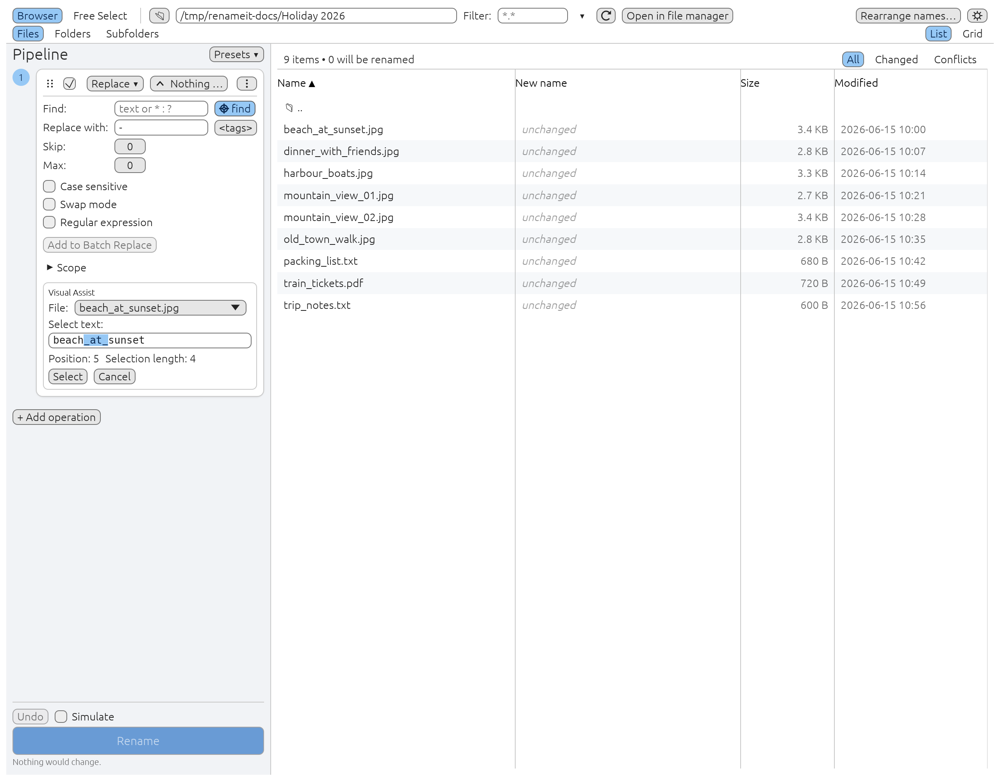

## Rearrange

Rearrange cuts a name into blocks and puts them in a new order: `Title - Author.pdf` becomes `Author - Title.pdf` for a whole folder. Files that do not have the sample's shape are left alone and flagged.

1. Press **Rearrange names…** in the source bar (or right-click a row → **Rearrange like this…**, or switch a card to Rearrange).
2. Pick a **Sample:** name.
3. **1 Cut:** the name is cut at its separators into coloured blocks. Click a separator to join the blocks either side; select text in the name and press **Split here** to cut there. **Guess again** cuts at the usual separators. Nine blocks at most.
4. **2 Build:** drag blocks into **New name:**, or click one to add it at the end. Type in the text box and press **+ Text** for your own text; **+ Tag ▾** adds a tag. Each block in the new name has **Aa** (case: **As is**, **Title Case**, **Sentence case**, **UPPER**, **lower**, and **Trim spaces**), ◀ ▶ to move it and × to leave it out. **Start again** clears it.
5. **3 Check:** the files in the list with their new names. *⚠ N files don't fit and will be left alone* names the misfits; **Show only these** lists just them.
6. Press **Add card** (or **Update card** when editing one).

**Guide me** shows the three steps one at a time with **Next** and **Back**. **Advanced** cuts by **A parts pattern** or **A regular expression** instead of **Separators in the sample**, and **Separators and expressions match case**.

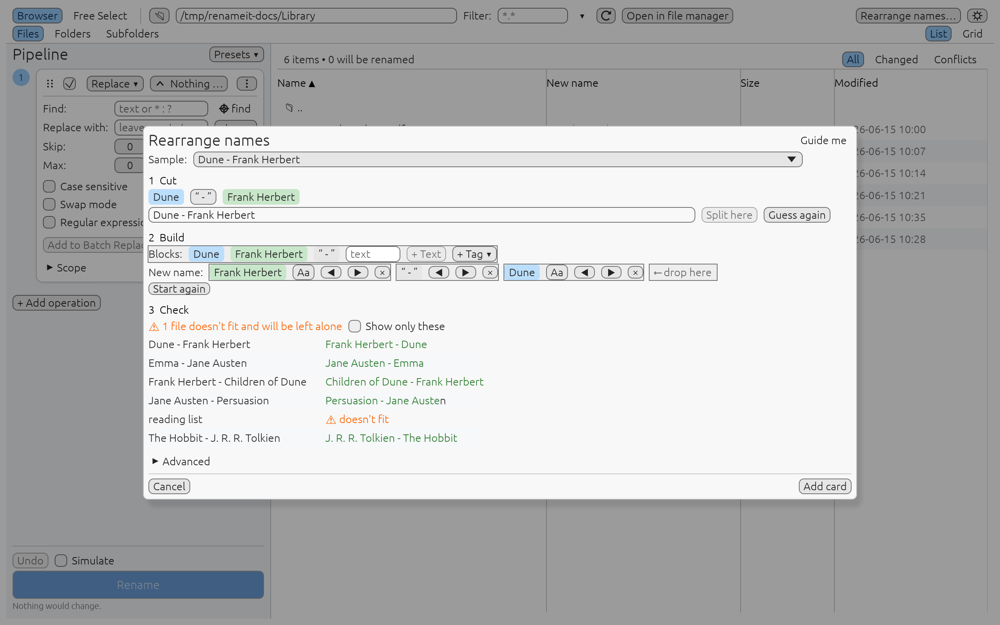

The card shows the rule and its **Cut by:** pattern; **Edit in builder…** reopens the window. In the list a file that does not fit says *unchanged* with ⚠, and the summary counts it as left alone.

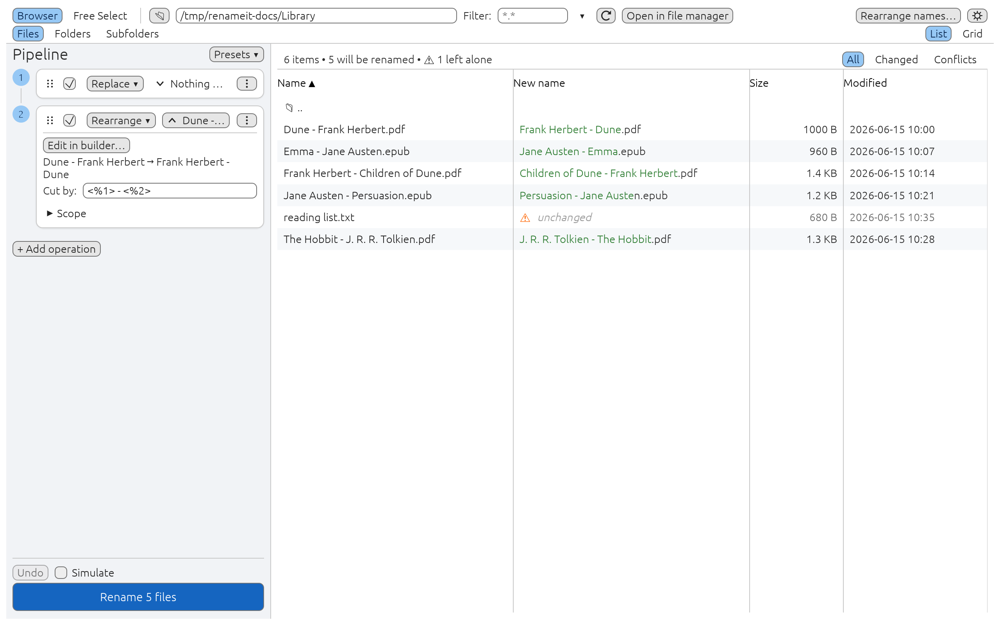 - <%2>; the list renames five books to Author - Title, and reading list.txt is unchanged with a warning sign, counted as 1 left alone" width="800">

## Music and images

**Music Rename** names each track from its own tags:

1. Add a card and pick **Music** → **Music Rename**.
2. Choose a style, such as `<Artist> - <Title>`, or **Custom:** and type your own pattern.
3. Tick **Only rename if all tags are available** to leave a file that is missing one of the pattern's tags alone. A file with none of them is always left alone.

**(edit styles)** opens Settings → [Music styles](#music-styles). Which formats and tags it reads: [Music and images](../README.md#music-and-images) in the README.

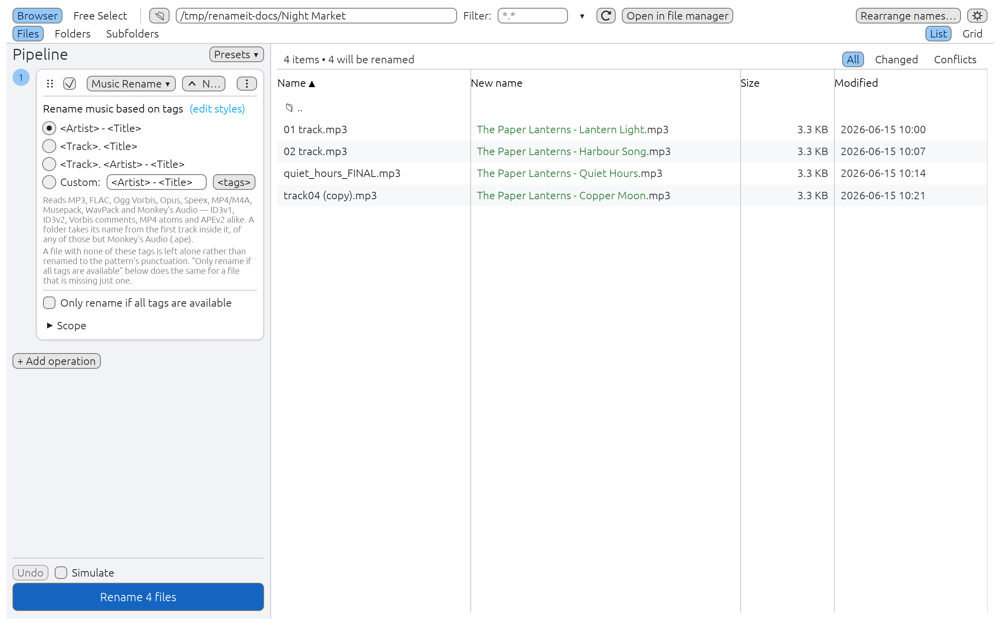

**Music Tagger** (writes tags from the filename) and **Remove Tags** (strips ID3v1, ID3v2 and Lyrics3 blocks) change what is *inside* a file, and neither can be undone. Before such a run RenameIt asks, and names every file:

1. Press **Run on N files**.
2. Read the list in **This run cannot be undone**.
3. Press **Change N item(s)** to go ahead, or **Leave everything alone** (also Escape) to stop.

A Scripting card that writes a file asks the same way (*A script asks to write N files*, **Write N files**).

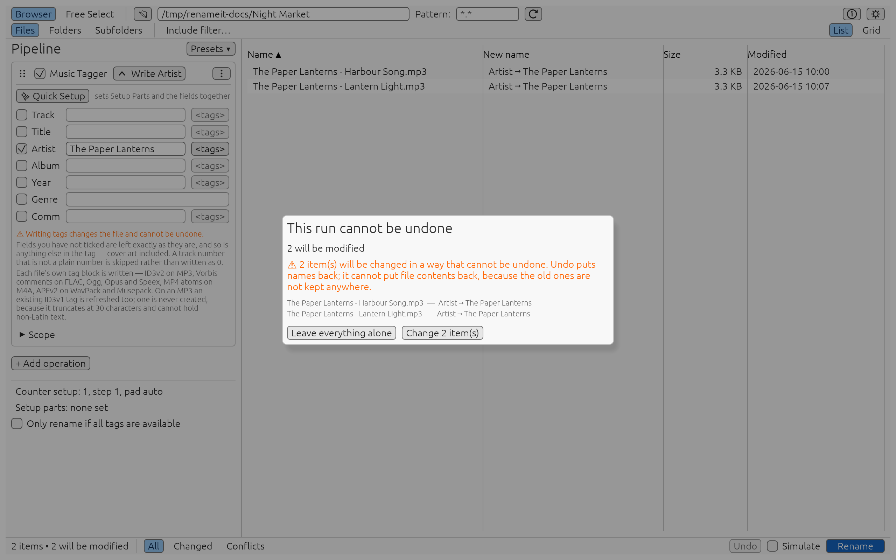

Fields you have not ticked on Music Tagger are left exactly as they are, cover art included.

## Tags and Ask

Any field that builds text takes `<tags>`: `<Name>`, `<Counter>`, `<Date-yyyy>`, `<Parent>`, `<%1>`, `<Crc32>` and the rest of [tags.md](tags.md). The **`<tags>`** button beside a field inserts one. A tag you mistype is an error, not empty text, and the card says so while you type.

`<Ask>` asks for the text when you run:

1. Put `<Ask>` (or `<Ask-1>` … `<Ask-9>`) in a field. The preview leaves it empty and the pipeline says *you are asked for it when you press Rename*.
2. Press **Rename**. The **Enter text** window has one box per `<Ask>`, and the first has the keyboard.
3. Type and press **Enter** (or **Rename**). **Cancel** renames nothing.

If the pipeline uses `<Clipboard>`, the window says it will be read when the rename starts.

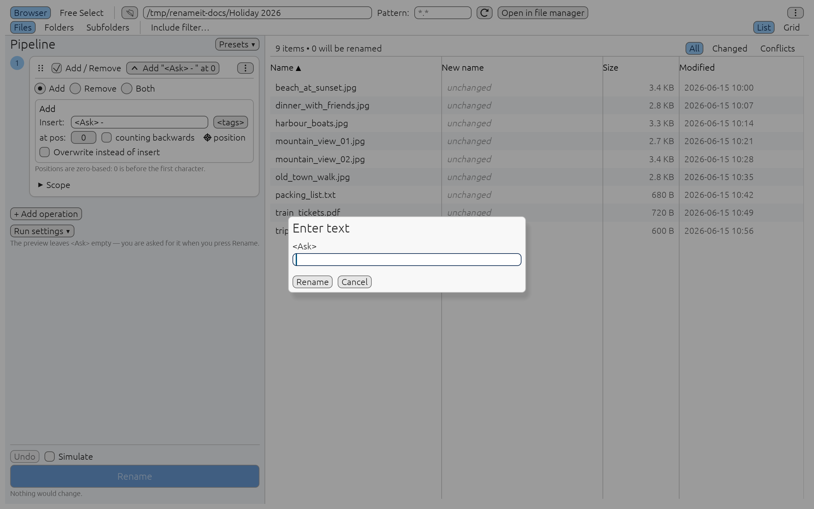 - at position 0, and the Enter text window with one <Ask> box, Rename and Cancel" width="800">

## Presets

A preset is a saved pipeline. It runs over whatever you have listed.

1. Press **Presets ▾** above the cards. The drawer opens on the right.
2. To save the pipeline, type a name in **Name this pipeline** and press **Save as preset**.
3. For a saved preset:
   - **Load** replaces the pipeline with it.
   - **Append** adds its operations to the end of the pipeline.
   - **Run** loads it and renames straight away (still asking for `<Ask>` and before anything irreversible).
   - ⋮ → **Rename…**, **Duplicate**, **Export…** or **Delete** (which asks: **Delete** / **Keep**).
4. **Import…** at the foot adds a preset from a `.toml` file. ✖ closes the drawer.

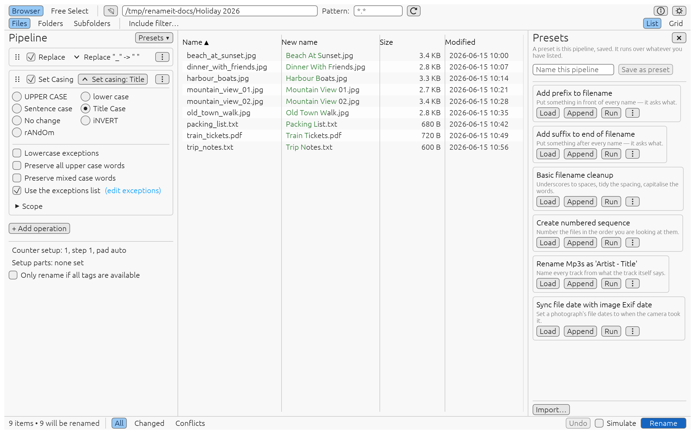

The six shipped presets are written the first time the app starts. Presets are files, one per preset, in the presets folder (Settings → [Where files are kept](#where-files-are-kept)); `ren-cli` runs the same files ([cli.md](cli.md)). On Windows, the Explorer right-click menu can list them (Settings → [Right-click menu](#right-click-menu)).

## If a run was interrupted

Every rename is written to a journal before it happens, so a crash, a power cut or a killed process leaves a record of exactly what was under way.

- **At the next start** a banner says *N batches did not finish* and names each file that was mid-change.
  - **Roll back** puts back what those batches did; **Leave as is** hides the banner and keeps the journals.
  - A journal another RenameIt window is still writing is named as running and is never offered for rollback.

  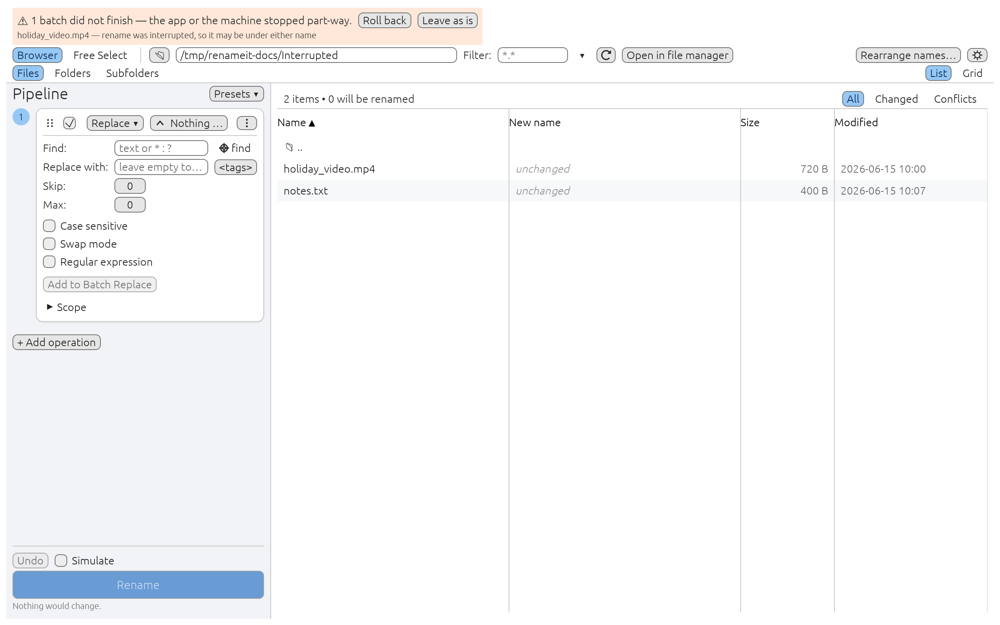

- **From the command line**, `ren-cli recover` lists the same, and `ren-cli recover --rollback` reverts them. An `apply` that exits 3 is the cue ([cli.md](cli.md)).
- **Cancel** during a run is not an interruption: it stops between two files, the run is recorded as finished, and Undo takes back exactly what happened.
- **What rollback and undo cannot restore:** a tag write or tag removal.
  - Those go through a copy that is swapped in whole, so a file is either as it was or fully changed, never half-written, but the old tags are gone.
- **A file changed since** (someone renamed or edited it, so it no longer matches the journal) is **skipped** and listed, never forced. A date is compared with two seconds' tolerance, because FAT stores times to two seconds.

## Settings

Press ⚙ at the top right, or **F8**. The rail on the left groups the pages under **General**, **File list**, **New cards**, **This computer** and **RenameIt**; **Close** is at the bottom right.

### Appearance

**Theme**: **System** (default), **Light** or **Dark**. **Interface size**: **90%** to **200%**, scaling text, spacing, icons and rows together. **Ctrl +** / **Ctrl −** do the same from anywhere in smaller steps; **Ctrl 0** puts it back to 100%.

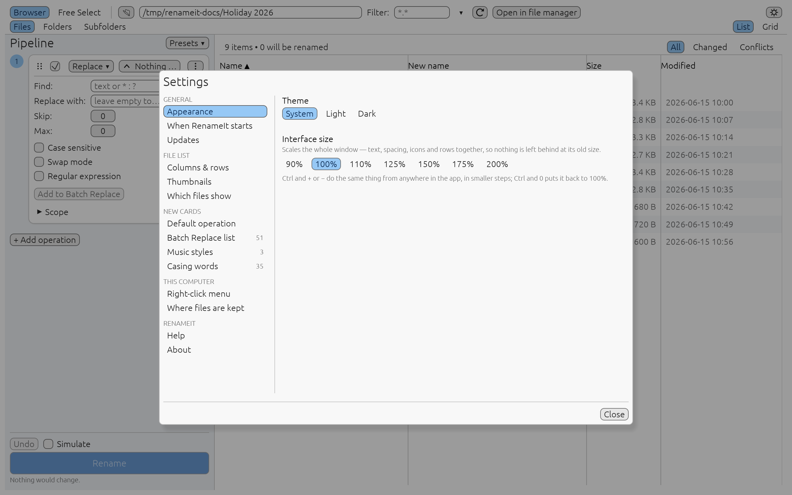

### When RenameIt starts

The app remembers where you were; these switches, all off by default, tell it what to forget. They take effect at the next start.

- **Uncheck Subfolders**, so a start is never slow.
- **Clear the pattern box**, so a forgotten `*.mp3` does not hide everything else.
- **Clear the pipeline**, so the next person at this machine does not see what you were renaming.

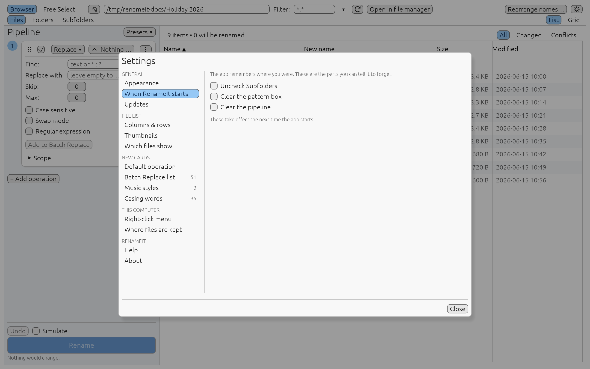

### Updates

On Windows:

- **Only when I ask**, the default. Nothing goes online until you press **Check now**.
- **Once a day — tell me when there is a new version**. The status line says when there is one.
- **Once a day — install it when I close RenameIt**. Only for a copy installed for you alone; one installed for everyone needs an administrator, so it is told instead.

**Update to X** downloads the installer, checks it against the release's `SHA256SUMS.txt`, closes RenameIt, installs it and opens it again. **What's new** opens the release notes. A portable copy gets **Open download page** instead. On other systems the page links to the releases page.

**Privacy:** a check asks `github.com` which release is the latest. Nothing is sent but that request, the User-Agent `RenameIt/<version>`, and your IP address, which any connection carries. An administrator can turn checks off with the DWORD `HKLM\SOFTWARE\Policies\RenameIt\DisableUpdateCheck` = 1.

### Columns & rows

- **Columns:** tick **Thumb**, **Name**, **New name**, **Size**, **Modified**, **Created**, **Ext**, **Folder**; order them with the arrows. **Name**, **New name**, **Size** and **Modified** are on by default; **Restore defaults** puts those back. Drag a column edge in the list to resize it.
- **Shade every other row**, **Folders above files** and **Numbers in names sort by value (2 before 10)**, all on by default.
- **Double-click on a file**: **Rename it** (default), **Open it** or **Do nothing**.
- **Double-click on a folder in Free Select**: **Do nothing** (default) or **Browse into it**.

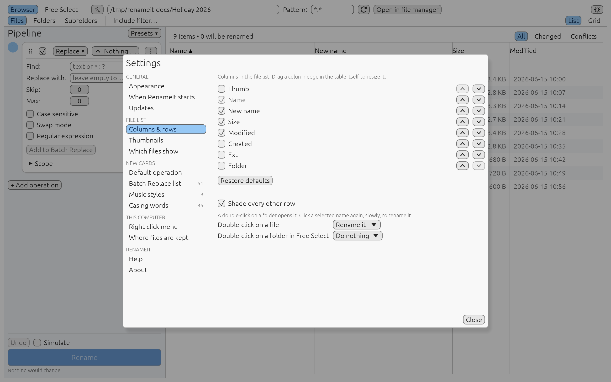

### Thumbnails

**Size** (48 to 256 pt, default 96) and **Draw a border around thumbnails**, for the Thumb column and the grid.

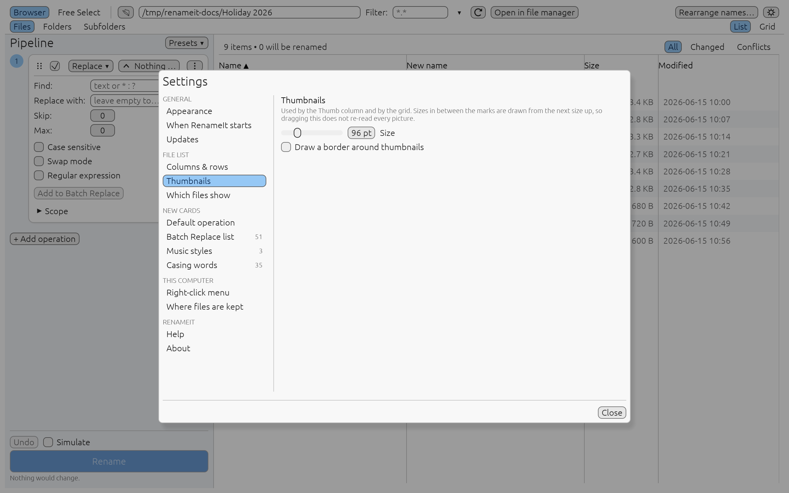

### Which files show

- **Show**: **Hidden files and folders**, **System files and folders**, **Write-protected files and folders**, all on by default.
- **Pattern box applies to**: **Both**, **Files** or **Folders**. Only matters with both Files and Folders switched on.
- **System folders**: **Refuse to rename inside operating-system folders** (on). With it on, Rename refuses inside `C:\Windows`, Program Files, `/usr`, `/etc` and the like, because undo cannot fix a machine that no longer boots.

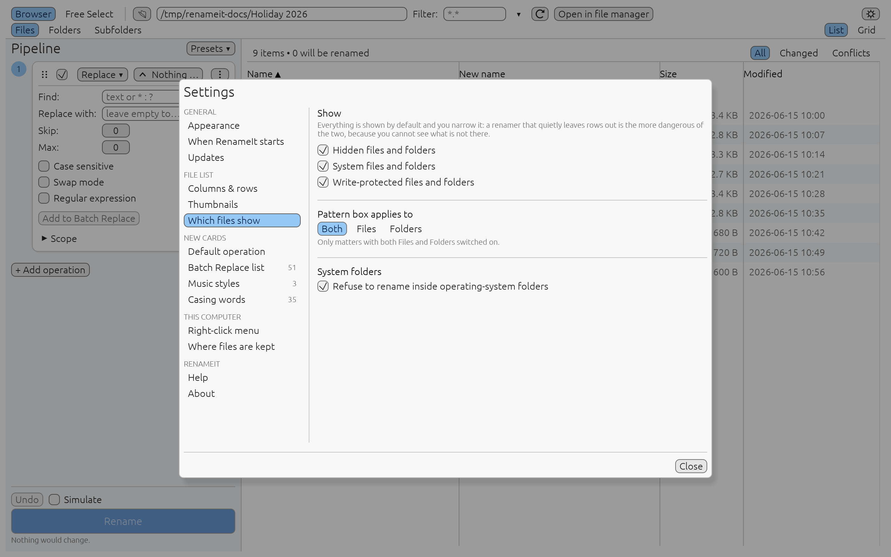

### Default operation

**New cards start as:** the operation **+ Add operation** and **Ctrl+K** add, and the one card an empty pipeline starts with. Replace by default.

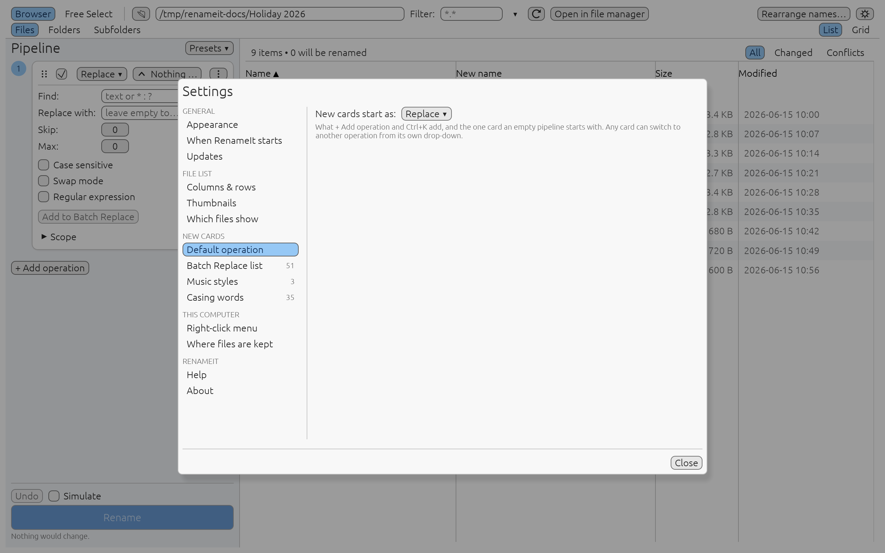

### Batch Replace list

The rules a new Batch Replace card starts from; the rail shows how many. A card keeps its own copy, so editing here never changes a pipeline or preset you already have. Type what to find and press **Add rule** (separate several with a colon, `a:b:c`); **Restore defaults** puts back the shipped list.

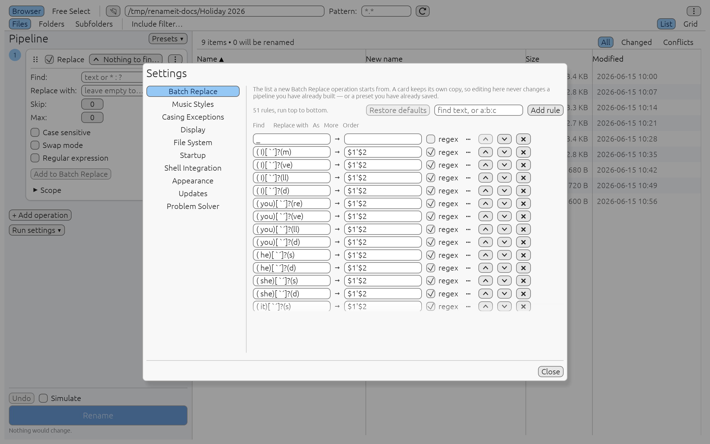

### Music styles

The patterns Music Rename offers. **+ Add style** adds one, × removes one, **Restore defaults** puts back the three shipped styles. A card keeps the pattern it chose, so editing here changes no existing pipeline.

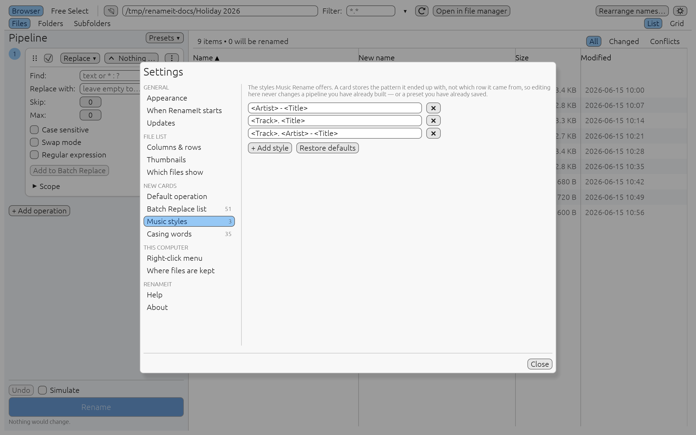

### Casing words

The words a new Set Casing card starts from:

- **Exception words**: written exactly as listed, whatever the mode (acronyms such as `CD`, `USA`).
- **Title Case lowercase exceptions**: left lowercase by Title Case unless they start the name.

Each list has **+ Add word** and **Restore defaults**.

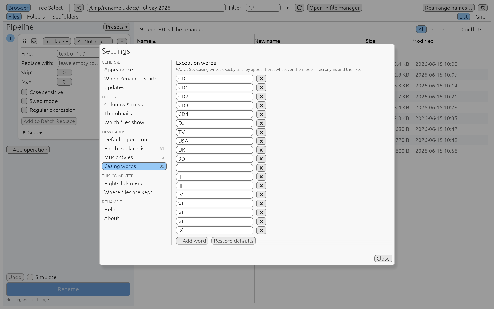

### Right-click menu

Windows only. **Show a RenameIt menu when I right-click files, folders and drives** puts RenameIt on Explorer's menu, for you alone. Then:

- **Entries**: **Start from this folder**, **Open in Free Select**, **Copy filenames to clipboard** and **Preset: …** for each preset (the first 40 fit). With one entry ticked, it sits directly on the menu.
- **Several items selected**: **Show only "Open in Free Select"** (default) or **Show the same menu as for one item**.
- **A folder in the selection opens in Free Select as**: **The folder itself** (default) or **The files inside it**.

On Windows 11 the menu is under **Show more options** (or **Shift+F10**). Windows hides the file entries for a selection longer than about 2000 characters (roughly 30 files); **Start from this folder** always works. A preset from the menu loads and shows the preview; it never renames by itself.

### Where files are kept

The **Undo journal**, **Presets** and **Scripts** folders this copy uses, each with 📂 to open it, and whether this is a portable copy. **Reset all settings…** puts every setting back to what the app ships with, after a confirmation that lists everything it restores, including the counter, the filename parts, the drop-downs' remembered values, Simulate, List or Grid and the filter. It never touches your files, presets, scripts, the undo journal, your pipeline or the folder you are in.

1. Press **Reset all settings…**.
2. Read the list.
3. Press **Restore every setting**, or **Leave my settings alone**.

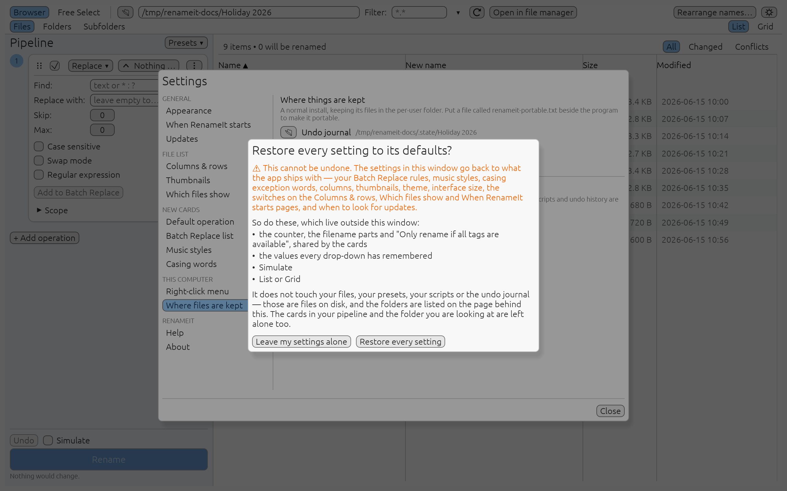

### Help

Answers to the problems people actually hit: a greyed-out Rename button, a tag that came out as text, files missing from the list, a run that left files behind, Undo greyed out after tagging music.

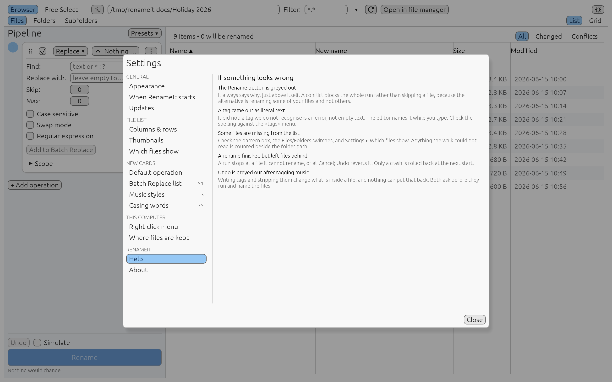

### About

The version, what this session renamed, the licence and the project link.

## Keyboard

| Key | Does |
|---|---|
| **F2** | Rename the row under the keyboard in place. The stem is selected; **Enter** renames and moves to the next row, **Escape** cancels. Honours Simulate. Refused while a run is going or the list is updating; a rename that fails says so in the status line. |
| **F3** | Visual Assist: open, cycle through the card's ⌖ targets, close. |
| **F4** or **Ctrl+Z** | Undo the last batch. |
| **F5** | Rename (run the plan). |
| **F6** | Put the keyboard in the address box (Browser mode). |
| **F8** | Settings. |
| **F9** | Forget everything read from inside the files, then list the folder again — the same as the ⟳ button. |
| **F12** | Pick a folder (Browser mode). |
| **Ctrl+K** | Add a card of the default operation (Settings → Default operation). |
| **↑ ↓ Home End** | Move through the list. **Shift** extends the selection; **Ctrl** moves the keyboard and leaves the selection alone. |
| **Ctrl+A** | Select every row on screen. |
| **Enter** / **Backspace** | Into the folder under the keyboard / up to the parent (Browser mode; Enter needs the Folders chip). Double-clicking `..` above the list goes up too. |
| **Delete** | Free Select only: take the selected rows out of the list. The files are untouched; nothing in the app deletes from disk. |
| **Ctrl +** / **Ctrl −** / **Ctrl 0** | Interface size (also in Settings → Appearance). |
| **Enter** in the `<Ask>` prompt | Answer and rename. |

Three rules decide when a key acts:

- **Exact modifiers:** Ctrl+Shift+Z is not undo, and Alt+F4 is not F4.
- **Not while you type:** in a text box the keys are the box's own — except F3, and except the F-keys in a number box (Ctrl+Z there undoes the digit).
- **Not behind a dialog:** with Settings, the `<Ask>` prompt or a confirmation open, no shortcut acts.

F1 is not bound. Closing the window while a run, an undo or a rollback is going waits for it to finish; Cancel stops a run sooner, between two files.

## Installing, portable mode and files

From the [latest release](https://github.com/phoen-ix/renameIt/releases/latest):

- **Windows installer**, `RenameIt-Setup-<version>.exe`. It installs for you alone by default, into `%LOCALAPPDATA%\Programs\RenameIt`, with no administrator prompt. *Anyone who uses this computer* installs into `Program Files` and asks for an administrator. Uninstalling keeps your presets, scripts and undo history unless you say otherwise.
  - Its *Right-click menu in Explorer* box (ticked) puts RenameIt on Explorer's right-click menu. On a computer several people use, each person gets it at their first start and can turn it off for themselves (Settings → [Right-click menu](#right-click-menu)).
  - For scripted installs, `/S` is silent, `/CurrentUser` or `/AllUsers` picks the scope and `/NOMENU` leaves the menu out: [packaging/README.md](../packaging/README.md).
- **Windows zip**, `RenameIt-windows-x64.zip`: a portable copy. Unzip it anywhere and run `renameit.exe`.
- **Linux**, `RenameIt-linux-x64.tar.gz`.

Updates: Settings → [Updates](#updates).

### Launching it

```text
renameit [PATH]... [--start-in] [--preset FILE] [--copy-names]
```

| Argument | Does |
|---|---|
| `PATH`… | Files or folders to open. One folder browses there; anything else is Free Select, the same reading a drag gets. |
| `--start-in` | Browse the folder the first path is in (a folder browses itself). |
| `--preset FILE` | Load a saved pipeline before the preview. A **path**, never a name: two presets may share one. The preview is shown; nothing is renamed. |
| `--copy-names` | Put the names of the given files on the clipboard, one per line, sorted, and exit without a window. |
| `--from-shell` | Written by the Explorer menu; nobody needs to type it. |

The parser never fails: anything it does not understand is read as a path, and the status line says so. A release build has no console, so `renameit --help` prints to nowhere on Windows — this table and `ren-cli --help` are the documented places.

### Portable mode

A copy that keeps everything beside itself. Put a file called `renameit-portable.txt` next to the executable and presets, scripts, the undo journal and the window layout all move into `RenameIt-data/` in that folder, so copying the folder to a stick takes them with it. The release zip ships the marker already; delete it to get the ordinary per-user behaviour. The installer leaves it out.

Two conditions, both required: the marker has to be there, and its folder has to be **writable**. A copy in `Program Files` or on a read-only share declines the portable path rather than taking it and failing on every write. Settings → [Where files are kept](#where-files-are-kept) says which mode you are in and where the files actually are.

### Where files live

The undo journal, presets, scripts and settings live in a per-user folder (on Windows under `%APPDATA%\RenameIt`), or in `RenameIt-data` beside a portable copy. `ren-cli` uses the same folders, so `ren-cli undo` can undo a batch the app ran. The table for each system: [cli.md](cli.md#where-renameit-keeps-its-files).
